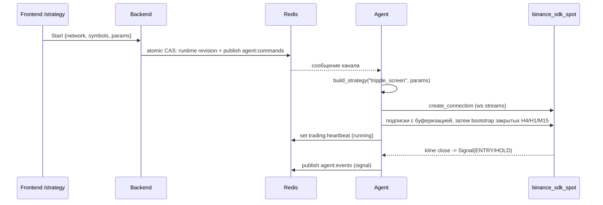

# Agent trading logic — DESIGN

Документ описывает, **как организован агент**: Стратегия — это его ядро,
а всё остальное — сервисная обвязка вокруг неё. Здесь зафиксированы границы
модулей и жёсткое требование по работе с биржей, чтобы новые стратегии и
сервисные функции добавлялись предсказуемо.

## Ключевые принципы

1. **Стратегия — основа Агента.** Стратегия анализирует данные и принимает
   решения. Обвязка (потоки данных, ордера, жизненный цикл, heartbeat) не
   содержит торговой логики и существует, чтобы обслуживать Стратегию.
2. **Работа с биржей — только через `binance_sdk_spot`.** Никаких своих моделей
   (`Quote`, `MarketData`, `NewOrder`, `OrderStatus`, ...): всё это есть в SDK.
   Разрешены лишь тонкие адаптеры над SDK (см. §3). Документация и примеры —
   в `binance-spot/docs/`, `binance-spot/examples/`.
3. **Boot-off без сохранённого намерения.** При отсутствии `agent:runtime.running=true`
   агент остаётся idle; новый запуск — командой `start` со страницы `/strategy`.
   Существующая семантика resume сохранена: ранее подтверждённое пользователем
   намерение `running=true` автоматически восстанавливается, в том числе для LIVE.
4. **Один канал backend↔agent — Redis** (команды + снапшот + heartbeat + события).
   У каждого сервиса своя БД; чужую схему никто не читает и не пишет.
5. **Рабочие символы — тоже агента.** Агент сам читает вселенную у биржи, сам
   проверяет отметки и хранит их в своей БД; backend лишь отдаёт опубликованный
   документ и передаёт выбор командой (см. §8).

## Роли

| Слой | Смысл |
|---|---|
| Strategy | ядро: анализ данных, эмиссия `Signal(ENTRY/EXIT/HOLD)` + provenance |
| Engine | жизненный цикл Стратегии, сборка сервисов, heartbeat, события |
| Commands | конверт команды + реестр обработчиков (`start`/`stop`/`balance`/`symbols`) |
| Universe / Selection | вселенная биржи, классификация символов и отметки пользователя |
| Exchange (adapters) | тонкие async-обёртки над `binance_sdk_spot` (REST + WS) |
| Backend | публикует команды, хранит снапшот намерения, отдаёт статус/результат |
| Frontend | `/strategy` (настройки + Start/Stop) и `/working-symbols` (отметки) |

Стратегия **не обращается к бирже напрямую** и **не определяет** размер позиции,
тип ордера, цену исполнения или защиту (`D-SIGNAL-ONLY`). Эти слои — следующие
шаги (см. §6).

## 1. Структура пакета `agent/agent/`

```
agent/agent/
├── main.py                    # демон: подписка на Redis + heartbeat
├── engine.py                  # Engine: lifecycle, сборка сервисов, heartbeat, events
├── models.py                  # таблицы агента (WorkingSymbol) — схема через create_all
├── selection.py               # чтение/запись/валидация отметок рабочих символов
├── symbols.py                 # вселенная биржи: классификация + публикация agent:symbols
├── common/
│   └── commands.py            # конверт/реестр @command + start/stop/balance/symbols + resume
├── exchange/
│   ├── rest.py                # ExchangeRest — async-обёртка Spot.rest_api
│   └── streams.py             # MarketDataStreams — обёртка Spot.websocket_streams
├── strategies/
│   ├── base.py                # Strategy ABC, StrategyServices, Signal
│   ├── registry.py            # @strategy(name), build_strategy
│   ├── __init__.py            # публичный API + авто-импорт стратегий
│   └── tripple_screen/        # конкретная Стратегия (spec STRATEGY_TRIPPLE_SCREEN)
│       ├── settings.py        # TripleScreenSettings (параметры spec §10)
│       ├── indicators.py      # EMA/SMA/Stochastic/Force Index (Decimal)
│       └── strategy.py        # @strategy("tripple_screen")
└── core/
    ├── config.py              # pydantic-settings (.env)
    └── db.py                  # движки БД + идемпотентное создание своей БД и схемы
```

Точка подключения торговой логики — **`strategies/`**. Движок и команды её не
знают по имени: они резолвят имя стратегии через реестр.

## 2. Поток запуска Стратегии



- Старт идёт от кнопки на `/strategy`; настройки = `params` в команде `start`.
- `Engine.start_run` валидирует `params` (через `TripleScreenSettings`), создаёт
  Стретегию, собирает `StrategyServices` и вызывает `strategy.on_start`.
- `Engine.stop` (или команда `stop`) гасит Стратегию и потоки, публикует `idle`.
  Lifecycle сериализован; ошибка старта откатывает частичные ресурсы и публикует
  `error`. Listener и heartbeat работают во время bootstrap; Stop отменяет
  активный и более ранние ожидающие Start, не отменяя Start после себя.
- `resume_from_runtime` при старте агента читает `agent:runtime`: если там
  `running=true` и стратегия известна — восстанавливает ран с теми же настройками.

## 3. Работа с биржей (обязательно через SDK)

Два адаптера — единственное место, где агент говорит с Binance:

- `exchange/rest.py` — `ExchangeRest`: `account`, `balances`, `klines`,
  `ticker_price`, `exchange_info`, `new_order`, `cancel_order`, `open_orders`,
  `get_order`. REST SDK блокирующий → всё через `asyncio.to_thread`. Возвращает
  **родные модели** (`GetAccountResponseBalancesInner`, `NewOrderResponse`, ...).
- `exchange/streams.py` — `MarketDataStreams`: одна WS-сессия
  (`Spot.websocket_streams.create_connection`), подписки `kline`/`ticker`/
  `book_ticker`; колбэки получают родные сообщения SDK (`KlineResponse`, ...).

Конфигурация клиента: `Spot(config_rest_api=ConfigurationRestAPI(api_key,
api_secret, base_path=<URL по сети>))` и
`Spot(config_ws_streams=ConfigurationWebSocketStreams(stream_url=<URL по сети>))`,
где URL и креды выбираются по `network` (`testnet`/`live`).

**Анти-паттерн (запрещено):** собственные dataclass/pydantic-модели ордеров,
котировок, баланса, свечей; ручной парсинг/маппинг enum'ов вместо SDK-enum;
своя реализация переподключений WS (SDK уже это делает).

## 4. Контракт Стратегии

```python
class Strategy(abc.ABC):
    name: ClassVar[str]                                  # ключ реестра
    def __init__(self, params: dict[str, Any]) -> None: ...
    async def on_start(self, services: StrategyServices) -> None: ...
    async def on_stop(self) -> None: ...
    # опционально: on_kline(symbol, interval, kline), on_price(symbol, price)
```

- `StrategyServices` — готовые `rest`, `streams`, `emit` (sink сигналов), сеть и
  список символов. Стратегия не строит клиентов сама.
- `Signal` — `type ∈ {ENTRY, EXIT, HOLD}`, `symbol`, `emitted_at`, а также
  `reason`/`epoch_id`/`entry_ref`/`swing_low_ref`/`tp_rule`/`valid_until`/
  `provenance`. Это выходной контракт стратегии, не модель биржи.

## 5. Triple Screen (текущая Стратегия)

Спецификация: `docs/STRATEGY_TRIPPLE_SCREEN.md`. Реализация:
`strategies/tripple_screen/`.

- `settings.py` — параметры §10 с дефолтами, доменными и межполевыми проверками.
  Конфигурация frozen, EMA-периоды — tuple; интервалы проверяются SDK-enum.
  Некорректные настройки отклоняются до остановки действующего запуска.
- `indicators.py` — чистые функции (`ema_series`, `sma_series`, `stochastic_k_series`,
  `force_index_series`) и внутренний `Candle`; всё на `Decimal`.
  **Seed-конвенция EMA — provisional** (SMA-seed), до `STRATEGY-05`.
- `strategy.py` — `on_start` сохраняет сервисы, подписывает WS с буферизацией
  закрытий и собирает полное настроенное окно через SDK REST. Окна дедуплицируются;
  snapshot ограничен временем конкретного M15, пропуски требуют backfill.
  Актуальность триггера ограничена закрытием следующего ripple или меньшим
  интервалом validity; backfill не продлевает её. Оценка
  (`BullishTide` → `PullbackUp` → триггер) даёт
  `ENTRY`/`HOLD` с reason-кодами (`no_pullback`, `no_trigger`, `position_open`,
  `cooldown`, `epoch_consumed`). Позиция/cooldown помечаются движком через
  `mark_position_open`/`mark_position_closed` (execution lane — следующий шаг).

## 6. Что ещё не реализовано (следующие слои обвязки)

Порядок — по спецификации:

1. **Execution lane** — по `Signal` считать размер и ставить ордера через
   `ExchangeRest` (округление под фильтры Binance, идемпотентные client-id).
2. **Position monitoring (spec §7)** — initial stop, trailing, TP по live-цене;
   приоритет ≥ входной оценки; инварианты spec §7.4 (v1.2: трейлинг до
   `fill × 1.04`, выход по времени через 8 ч). План: `docs/ORDER_EXECUTION_PLAN.md`.
3. **Universe scan в самой Стратегии (spec §1)** — H4 slope, top-N по 24h volume,
   динамический WS-set. Сам список торгуемых символов и его отбор уже есть (§8),
   но Стратегия пока берёт символы из `start`, а не сканирует их сама.
4. **Fills/портфель** — user-data stream или REST-реконсиляция; персистентный
   cooldown через рестарт.
5. **Audit chain (spec §8)** — market state → signal → intent → risk → order →
   outcome, включая no-order `HOLD`.

Каждый слой — сервис **вокруг** Стратегии; Стратегия остаётся ядром и не знает
деталей исполнения.

## 7. Влияние на backend/frontend

- `backend/app/api/routes/trading.py`: команды/снапшот/статус/результат. Список
  стратегий и правила их параметров здесь **не** перечисляются: агент публикует их
  в `agent:strategies`, а `backend/app/core/strategy_catalog.py` компилирует
  опубликованное и проверяет `params` до записи в Redis. `protector` удалён.
- `frontend/src/routes/_layout/strategy.tsx`: форма настроек строится из каталога
  агента (лейблы — `title` полей, значения — `default`, междоменные правила —
  `constraints`); локальных копий схемы Triple Screen нет. Шлёт
  `start {network, strategy, symbols, params}`.
- `/trading` — только наблюдение и отдельный запрос баланса; никаких неявных Start.
- `GET /trading/status/` (superuser) возвращает `{desired, actual, online}`.
  `desired` содержит params и revision, `actual` — последний heartbeat со своей
  сетью/стратегией/балансом. Offline heartbeat не подтверждает текущий запуск.
- HTTP 202 подтверждает приём, не исполнение. UI отслеживает результат по ID;
  `GET /trading/result/?command_id=UUID` доступен superuser. Агент сохраняет
  `agent:result:<id>` на 3600 секунд и legacy `agent:result`.
- Событие Redis: `{"kind":"signal", **signal.transport()}` — полный контракт,
  цены Decimal сериализуются строками. Retry в памяти сохраняет `signal_id`;
  эпоха потребляется после успешного emit. Просроченные сигналы не повторяются.
  Pub/Sub не предоставляет durable/exactly-once; потребители дедуплицируют ID.
- Клиент генерируется из openapi (см. `CONTEXT.md` §5); вручную не правится.
- Символы и цены: `GET /trading/symbols/` отдаёт `agent:symbols` как есть (`available=false`,
  если агент ещё не публиковал), `POST /trading/symbols/` шлёт команду `symbols`
  (202 + конверт), `POST /trading/prices/` — команду `prices`. Backend отбрасывает
  только неверный формат (422); «годится ли символ» решает агент и сообщает причину
  через `/result/`. Страница `/working-symbols` (superuser) сортирует таблицу по любому
  столбцу, показывает цену и сохраняет весь набор; `/strategy` ссылается на неё вместо
  поля ввода и берёт отмеченные пригодные символы в `start`. Подробности — §8.

## 8. Торгуемая вселенная и рабочие символы

Список символов принадлежит агенту: он единственный говорит с биржей и единственный
может сказать, годится ли символ.

- `agent/symbols.py` читает публичный `exchangeInfo` + 24h tickers, классифицирует
  каждый USDT-символ и публикует документ в `agent:symbols` (на старте и раз в
  5 минут; неудачное обновление оставляет прежний документ). Поля каждой записи:
  `status`, `spot_allowed`, `quote_volume_24h` (Decimal-строка), `last_price`
  (Decimal-строка или `null`), `classification`, `classification_label`,
  `excluded_reason`, `selected`; у документа — `generated_at` и `prices_updated_at`.
- **«Особых отметок» биржи не существует в spot-API**: у `exchangeInfo` нет `tags`,
  `additional_properties` пуст у всех символов, новостей о делистинге там тоже нет.
  Поэтому `excluded_reason` — **наша** классификация по `status`,
  `is_spot_trading_allowed` и базовому активу: trading halted or delisted, spot
  trading not allowed, stablecoin/fiat, gold (`PAXG`/`XAUT`), wrapped or staked,
  tokenized equity, non-latin name. Токенизированные акции Binance называет
  `<TICKER>B`: известный тикер отдаётся как факт, любой другой `*B` — как догадка
  для проверки (`suspected_tokenized_equity`). Владелец подтвердил исключение 12
  найденных на 2026-09-15 таких символов; исключения из правила для них не нужны.
  Memecoins — только метка, из вселенной не исключаются (пользователь снимает их
  руками); эта политика также подтверждена владельцем.
- **Отметки хранятся в БД агента** (`agent/models.py:WorkingSymbol`, PK `symbol`):
  строка и есть отметка, поэтому «что выбрано» и «что есть» не расходятся.
  `agent/core/db.py` идемпотентно создаёт свою БД и схему на каждом старте;
  недоступная БД не мешает торговле. Backend к таблице не обращается — только к
  опубликованному документу (принцип 4).
- Команда `symbols` (payload `{symbols: [...]}`) заменяет набор целиком: агент
  проверяет **весь** набор против вселенной и отклоняет запрос целиком, если хоть
  один символ непригоден, — частичная запись оставила бы ложное впечатление, что
  отмечено всё. Отмеченный символ, переставший подходить, не удаляется молча: он
  остаётся отмеченным, а документ называет причину и считает `selected_unusable`.
- **Цены читаются по запросу, а не постоянно.** `last_price` приходит из того же
  24h-тикера, что и объём, поэтому периодическая публикация не делает лишних вызовов,
  но между публикациями цена стареет. Команда `prices` заставляет агента перечитать
  тикеры сейчас, обновить `last_price` и `quote_volume_24h` (их отдаёт один и тот же
  эндпоинт) и `prices_updated_at`, затем перепубликовать документ. `null` в
  `last_price` означает «цены не читали», а не нулевую цену. Неудачное чтение не
  обнуляет данные и не мешает торговле. Цену читают по кнопке потому, что спрос на
  свежее число знает только пользователь, а каждый запрос — это обращение к бирже.
- `prices` и `balance` — observation-only: в снапшот намерения они не пишут (иначе
  запрос цены молча выставлял бы «остановлено») и вне очереди start/stop в агенте,
  чтобы медленное чтение биржи не задерживало Stop.
- **Метка Monitoring.** У биржи есть «Monitoring Tag»: актив торгуется как обычно, но
  биржа периодически его пересматривает и может делиститься. В официальном spot-API
  метки нет: у `exchangeInfo` одинаковые 26 полей на всех 3699 символах, строк `tag`
  и `monitoring` в ответе нет вообще; futures отдаёт только `underlyingSubType`.
  Безавторизационный источник — страница
  `https://www.binance.com/en/markets/coinInfo-Monitoring`, но она закрыта AWS WAF
  (обычный HTTP-клиент получает `202` и JS-челлендж), поэтому читается JSON, из которого
  эта страница сама рендерится (`.../asset-service/product/get-products`, поле `tags`).
- **Адаптер подчёркнуто поддельный.** `agent/monitoring.py` — единственное место, где
  агент ходит не через `binance_sdk_spot` (это витрина сайта, а не биржа). Он изолирован
  одним узким швом (`MonitoringFeed.fetch` + инъектируемый transport), называет
  страницу, которую замещает, и заменяется или удаляется без правок в остальном агенте.
- **Режим отказа безопасен и задокументирован:** любая ошибка (HTTP, таймаут, не-JSON,
  неожиданная форма) → `MonitoringError`, и **сохранённые метки остаются**. Провал
  чтения не должен превращать «под мониторингом» в «чисто»: «неизвестно» — это не «нет
  метки». Валидный фид, не помечающий ничего, тоже считается ошибкой: биржа всегда
  что-то помечает, поэтому пустой список означал бы смену формата, а очистка всех меток —
  единственная ошибка, которая реально вредит. Сама метка — только ярлык: не фильтрует,
  не блокирует, не валит команды.
- Список хранится в БД агента (`agent/models.py:MonitoredSymbol`, строка = метка),
  потому что переживает рестарт и иногда будет участвовать в решениях. В документ он
  попадает как `monitoring` у записи и `monitoring_updated_at` у документа (свежесть
  выводится из `max(updated_at)` строк, и это корректно именно потому, что пустой
  список не сохраняется). Читается раз в сутки (`_monitoring_loop` в `main.py`): метка
  меняется с объявлением биржи, а не внутри дня.
- UI: `/working-symbols` — таблица с сортировкой по каждому столбцу (чекбокс
  участия, имя, цена, 24h volume, отметки), тумблер «показать непригодные», массовый
  выбор всех/по объёму/с меткой Monitoring, инверсия пригодного выбора и кнопка
  `Request prices` с отметкой, когда цены прочитаны; сохранение отправляет весь набор.
  В столбце «отметки» метка Monitoring показывается значком (треугольник с
  восклицательным знаком) и подсказкой; она не влияет ни на что, кроме вида.
  `/strategy` больше не вводит символы текстом: ссылка на эту страницу, а `start`
  берёт отмеченные пригодные символы.
