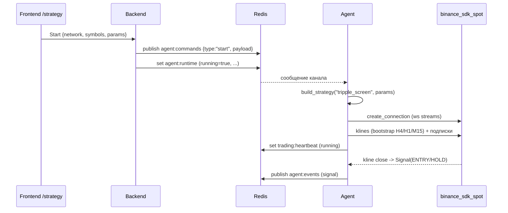

# Agent trading logic — DESIGN

Документ описывает, **как организован агент**: Стратегия — это его ядро,
а всё остальное — сервисная обвязка вокруг неё. Здесь зафиксированы границы
модулей и жёсткое требование по работе с биржей, чтобы новые стратегии и
сервисные функции добавлялись предсказуемо.

## Ключевые принципы

1. **Стратегия — основа Агента.** Стратегия анализирует данные и принимает
   решения. Обвязка (потоки данных, ордера, жизненный цикл, heartbeat) не
   содержит торговой логики и существует, чтобы обслуживать Стратегию.
2. **Работа с биржей — только через `binance_sdk_spot`.** Никаких своих моделей
   (`Quote`, `MarketData`, `NewOrder`, `OrderStatus`, ...): всё это есть в SDK.
   Разрешены лишь тонкие адаптеры над SDK (см. §3). Документация и примеры —
   в `binance-spot/docs/`, `binance-spot/examples/`.
3. **Boot-off.** Система стартует с выключенной Стратегией; запуск — только
   командой `start` с настройками со страницы UI.
4. **Один канал backend↔agent — Redis** (команды + снапшот + heartbeat + события).
   У каждого сервиса своя БД; чужую схему никто не читает и не пишет.

## Роли

| Слой | Смысл |
|---|---|
| Strategy | ядро: анализ данных, эмиссия `Signal(ENTRY/EXIT/HOLD)` + provenance |
| Engine | жизненный цикл Стратегии, сборка сервисов, heartbeat, события |
| Commands | конверт команды + реестр обработчиков (`start`/`stop`/`balance`) |
| Exchange (adapters) | тонкие async-обёртки над `binance_sdk_spot` (REST + WS) |
| Backend | публикует команды, хранит снапшот намерения, отдаёт статус/результат |
| Frontend | страница `/strategy`: настройки Стратегии + Start/Stop |

Стратегия **не обращается к бирже напрямую** и **не определяет** размер позиции,
тип ордера, цену исполнения или защиту (`D-SIGNAL-ONLY`). Эти слои — следующие
шаги (см. §6).

## 1. Структура пакета `agent/agent/`

```
agent/agent/
├── main.py                    # демон: подписка на Redis + heartbeat
├── engine.py                  # Engine: lifecycle, сборка сервисов, heartbeat, events
├── common/
│   └── commands.py            # конверт/реестр @command + start/stop/balance + resume
├── exchange/
│   ├── rest.py                # ExchangeRest — async-обёртка Spot.rest_api
│   └── streams.py             # MarketDataStreams — обёртка Spot.websocket_streams
├── strategies/
│   ├── base.py                # Strategy ABC, StrategyServices, Signal
│   ├── registry.py            # @strategy(name), build_strategy
│   ├── __init__.py            # публичный API + авто-импорт стратегий
│   └── tripple_screen/        # конкретная Стратегия (spec STRATEGY_TRIPPLE_SCREEN)
│       ├── settings.py        # TripleScreenSettings (параметры spec §10)
│       ├── indicators.py      # EMA/SMA/Stochastic/Force Index (Decimal)
│       └── strategy.py        # @strategy("tripple_screen")
└── core/
    ├── config.py              # pydantic-settings (.env)
    └── db.py                  # движки БД (опционально)
```

Точка подключения торговой логики — **`strategies/`**. Движок и команды её не
знают по имени: они резолвят имя стратегии через реестр.

## 2. Поток запуска Стратегии



- Старт идёт от кнопки на `/strategy`; настройки = `params` в команде `start`.
- `Engine.start_run` валидирует `params` (через `TripleScreenSettings`), создаёт
  Стретегию, собирает `StrategyServices` и вызывает `strategy.on_start`.
- `Engine.stop` (или команда `stop`) гасит Стратегию и потоки, публикует `idle`.
- `resume_from_runtime` при старте агента читает `agent:runtime`: если там
  `running=true` и стратегия известна — восстанавливает ран с теми же настройками.

## 3. Работа с биржей (обязательно через SDK)

Два адаптера — единственное место, где агент говорит с Binance:

- `exchange/rest.py` — `ExchangeRest`: `account`, `balances`, `klines`,
  `ticker_price`, `exchange_info`, `new_order`, `cancel_order`, `open_orders`,
  `get_order`. REST SDK блокирующий → всё через `asyncio.to_thread`. Возвращает
  **родные модели** (`GetAccountResponseBalancesInner`, `NewOrderResponse`, ...).
- `exchange/streams.py` — `MarketDataStreams`: одна WS-сессия
  (`Spot.websocket_streams.create_connection`), подписки `kline`/`ticker`/
  `book_ticker`; колбэки получают родные сообщения SDK (`KlineResponse`, ...).

Конфигурация клиента: `Spot(config_rest_api=ConfigurationRestAPI(api_key,
api_secret, base_path=<URL по сети>))` и
`Spot(config_ws_streams=ConfigurationWebSocketStreams(stream_url=<URL по сети>))`,
где URL и креды выбираются по `network` (`testnet`/`live`).

**Анти-паттерн (запрещено):** собственные dataclass/pydantic-модели ордеров,
котировок, баланса, свечей; ручной парсинг/маппинг enum'ов вместо SDK-enum;
своя реализация переподключений WS (SDK уже это делает).

## 4. Контракт Стратегии

```python
class Strategy(abc.ABC):
    name: ClassVar[str]                                  # ключ реестра
    def __init__(self, params: dict[str, Any]) -> None: ...
    async def on_start(self, services: StrategyServices) -> None: ...
    async def on_stop(self) -> None: ...
    # опционально: on_kline(symbol, interval, kline), on_price(symbol, price)
```

- `StrategyServices` — готовые `rest`, `streams`, `emit` (sink сигналов), сеть и
  список символов. Стратегия не строит клиентов сама.
- `Signal` — `type ∈ {ENTRY, EXIT, HOLD}`, `symbol`, `emitted_at`, а также
  `reason`/`epoch_id`/`entry_ref`/`swing_low_ref`/`tp_rule`/`valid_until`/
  `provenance`. Это выходной контракт стратегии, не модель биржи.

## 5. Triple Screen (текущая Стратегия)

Спецификация: `docs/STRATEGY_TRIPPLE_SCREEN.md`. Реализация:
`strategies/tripple_screen/`.

- `settings.py` — все параметры §10 (timeframes, EMA, Stochastic, FI, пороги,
  стопы/TP, cooldown, лимиты данных) с дефолтами; `from_params` отбрасывает
  незнакомые ключи.
- `indicators.py` — чистые функции (`ema_series`, `sma_series`, `stochastic_k_series`,
  `force_index_series`) и внутренний `Candle`; всё на `Decimal`.
  **Seed-конвенция EMA — provisional** (SMA-seed), до `STRATEGY-05`.
- `strategy.py` — `on_start` бутстрапит H4/H1/M15 через REST и подписывается на
  WS kline; оценка на закрытии M15 (`BullishTide` → `PullbackUp` → триггер) даёт
  `ENTRY`/`HOLD` с reason-кодами (`no_pullback`, `no_trigger`, `position_open`,
  `cooldown`, `epoch_consumed`). Позиция/cooldown помечаются движком через
  `mark_position_open`/`mark_position_closed` (execution lane — следующий шаг).

## 6. Что ещё не реализовано (следующие слои обвязки)

Порядок — по спецификации:

1. **Execution lane** — по `Signal` считать размер и ставить ордера через
   `ExchangeRest` (округление под фильтры Binance, идемпотентные client-id).
2. **Position monitoring (spec §7)** — initial stop, trailing, TP по live-цене;
   приоритет ≥ входной оценки; инвариант `stop < fill < tp`.
3. **Universe scan (spec §1)** — eligible-фильтры, H4 slope, top-N по 24h volume,
   динамический WS-set.
4. **Fills/портфель** — user-data stream или REST-реконсиляция; персистентный
   cooldown через рестарт.
5. **Audit chain (spec §8)** — market state → signal → intent → risk → order →
   outcome, включая no-order `HOLD`.

Каждый слой — сервис **вокруг** Стратегии; Стратегия остаётся ядром и не знает
деталей исполнения.

## 7. Влияние на backend/frontend

- `backend/app/api/routes/trading.py`: команды/снапшот/статус/результат;
  `KNOWN_STRATEGIES` синхронизирован с реестром агента. `protector` удалён.
- `frontend/src/routes/_layout/strategy.tsx`: настройки Стратегии (жёстко под
  параметры Triple Screen) + Start/Stop; шлёт `start {network, strategy, symbols, params}`.
- Клиент генерируется из openapi (см. `CONTEXT.md` §5); вручную не правится.
