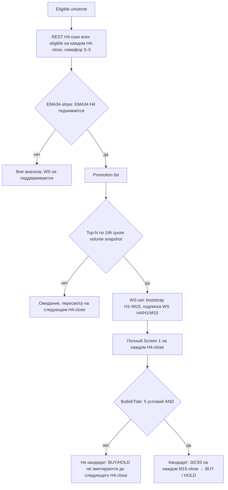

# Стратегия «Три Экрана» (Triple Screen) — Strategy Spec v1.0

- **Owner decision:** `OWNER-STRATEGY-02`
- **Статус:** утверждено владельцем
- **История:** Design Draft v0.1
- **Продукт:** Binance Spot, **long-only**

Документ описывает точный алгоритм стратегии для исполнителя. Разделы 1–8
разделы 9–13 —
инженерные следствия (сигнальный контракт, данные, конфиг, критерии приёмки,
границы).

---

## 0. Нотация

- Для каждого timeframe закрытые бары индексируются с конца: `[1]` — последний
  закрытый бар, `[2]` — предыдущий, `[i]` — i-й с конца.
- `close(TF)[i]`, `high(TF)[i]`, `low(TF)[i]`, `volume(TF)[i]` — значения
  закрытого бара `i` соответствующего TF.
- В формулах событий Экрана 2 индекс `t` обозначает бар оценки в последовательности
  закрытых H1-баров, `t−1` — предшествующий ему.
- Все сравнения EMA — строгие (`>`). Пересечение порога oversold — по формуле
  из §4.4 (с `≥`/`<`), как утверждено владельцем.
- Все цены — `Decimal`; точная decimal/rounding policy и seed-конвенция EMA
  фиксируются индикаторной спецификацией с hand-calculated fixtures (`STRATEGY-05`).

---

## 1. Universe и правила выбора symbols

### 1.1 Eligible universe (фильтры, применяются до любой оценки)

1. Binance Spot symbols, котируемые в `USDT` (default) **или** `USDC` (выбор
   до запуска, глобально на весь рантайм; смешанный набор запрещён);
2. активный Spot trading status;
3. минус `EXCEPTION_ASSETS`.

Фильтры перепроверяются на каждом такте сканирования. Символ с открытой позицией,
потерявший trading status, не получает новых входов, но мониторинг его позиции
продолжается до закрытия (safety).

### 1.2 Pipeline отбора



Стадии:

| Стадия | Триггер пересмотра | Действие |
|---|---|---|
| 1. REST-скан | каждый H4-close | H4-снапшоты закрытых свечей для **всех** eligible, семафор 3–5 одновременных загрузок (конфиг, default 3) |
| 2. Slope-filter | каждый H4-close | `EMA(34)[1] > EMA(34)[2]` (строго) → promotion list |
| 3. Top-N / WS-set | каждый H4-close | ранжирование promotion list по 24h quote volume snapshot (desc, tie-break: symbol asc); top-N (default 50) → WS-set |
| 4. Экран 1 | каждый H4-close | для WS-set: BullishTide = AND 5 условий (§4.2) |
| 5. Экраны 2–3 | каждый M15-close | только для BullishTide-символов: PullbackUp + M15-триггер → BUY / HOLD |

Правила жизненного цикла WS-set:

- Promotion в WS-set → REST bootstrap H1 и M15 (окно 1000, `OWNER-KLINE-01`) →
  подписка WS (H4, H1, M15). Динамический add/remove без рестарта — `MARKET-05`.
- Symbol выбывает из WS-set на следующем H4-close, если slope не прошёл или
  символ вне top-N → отписка WS.
- Символы вне WS-set не участвуют в анализе, WS для них не поддерживается.

---

## 2. Три timeframes

| Экран | Роль | TF | Соотношение |
|---|---|---|---|
| 1 — Tide | стратегический тренд, сторона торговли | **H4** | ×4 к wave |
| 2 — Wave | откат против тренда (дисконт) | **H1** | ×4 к ripple |
| 3 — Ripple | триггер входа | **M15** | — |

Комбинация `H4-H1-M15` — конфиг (versioned, задаётся до запуска). Engine не
хардкодит набор (`D-MARKET`, ADR-012 cl. 6).

---

## 3. Индикаторы и формулы

### 3.1 Экран 1 — Tide (H4): выстраивание трёх EMA и цены

```
EMA(p)[i] — EMA периода p по close, на закрытых H4-барах (периоды 5 / 13 / 34)

BullishTide = (EMA(5)[1]  > EMA(5)[2])
          ∧ (EMA(13)[1] > EMA(13)[2])
          ∧ (EMA(34)[1] > EMA(34)[2])
          ∧ (EMA(5)[1]  > EMA(13)[1])
          ∧ (close(H4)[1] > EMA(34)[1])
```

- `BullishTide` — AND **всех пяти** строгих условий.
- `BearishTide` — AND тех же пяти условий с инвертированными сравнениями.
  Используется **только** как наблюдаемая классификация (provenance): шортов нет,
  trend-flip exit удалён, ни одно правило на `BearishTide` не опирается.
- MACD не используется.

### 3.2 Экран 2 — Wave (H1): Stochastic + Force Index

```
%K[t]     = 100 × (close[t] − LL(5)[t]) / (HH(5)[t] − LL(5)[t])
%D[t]     = SMA(%K, 3)[t]
Slow%D[t] = SMA(%D, 3)[t]                     # только provenance

raw_FI[t] = (close[t] − close[t−1]) × volume[t]   # volume — base asset, без конвертации
FI[t]     = EMA(raw_FI, 2)[t]
```

`LL(5)`, `HH(5)` — минимум/максимум `low`/`high` за последние 5 закрытых H1.
Если `HH(5)[t] = LL(5)[t]` (плоское окно) — бар `t` не может дать `PullbackUp`.

Пара `Stochastic + ForceIndex` — обязательная пара подтверждения (**AND**).

### 3.3 PullbackUp (готовность отката к развороту вверх)

```
Ov = OversoldThreshold (конфиг, default 20)

PullbackUp[t] = (%K[t−1] < Ov)  ∧ (%K[t] ≥ Ov)
            ∧ (%K[t−1] ≤ %D[t−1]) ∧ (%K[t] > %D[t])
            ∧ (FI[t−1] < 0) ∧ (FI[t] ≥ 0)
```

Все шесть под-условий — на одном и том же закрытом H1-баре `t`.

**Бар оценки:** последний закрытый H1, у которого `close_time ≤ open_time`
триггерного M15-бара (т. е. H1, не пересекающийся с триггерным баром). Это
гарантирует, что Э2 описывает состояние **до** триггерного бара: нет защёлкивания,
отдельный max-age не нужен.

### 3.4 Экран 3 — Ripple (M15): триггер пробоя

```
EntryTriggerLong = close(M15)[1] > high(M15)[2]      # строго; равенство — не сигнал
```

Триггерный бар — последний закрытый M15; оценка выполняется в момент его закрытия.
`entry_ref = close(M15)[1]`.

---

## 4. BUY / SELL / HOLD условия

Оценка — **только по закрытым свечам**, один раз на каждом закрытии M15-свечи,
для символов WS-set с подтверждённым `BullishTide`.

```
BUY(symbol) = BullishTide(H4)                              # Экран 1
          ∧ PullbackUp(H1, бар до открытия триггерного M15) # Экран 2
          ∧ EntryTriggerLong(M15)                          # Экран 3
          ∧ NoOpenPosition(symbol)                         # одна позиция на символ
          ∧ CooldownExpired(symbol)                        # §6
          ∧ EpochFresh(symbol, trigger_bar)                # §4.1
```

- **BUY** → эмитируется ENTRY-сигнал (§9).
- **SELL** — не существует: Spot, long-only, структурно нет short-пути.
- **HOLD** — когда BUY не эмитирован, для BullishTide-символов, на каждом M15-close.
  Reason-коды: `no_pullback`, `no_trigger`, `position_open`, `cooldown`,
  `epoch_consumed`. HOLD — durable запись в audit chain (`D-AUDIT`).
  Символы с `BullishTide = false` HOLD **не** эмитируют (они не кандидаты).

### 4.1 Эпоха сигнала (epoch semantics)

- `epoch_id = (symbol, open_time триггерного M15-бара)`.
- **Одна** ENTRY-эмиссия на эпоху. После эмиссии (независимо от решения Risk)
  эпоха считается потреблённой → до нового триггерного бара `HOLD(epoch_consumed)`.
- Новый M15-бар, удовлетворяющий `EntryTriggerLong`, открывает новую эпоху.

### 4.2 Окно валидности сигнала

- ENTRY-сигнал несёт `emitted_at` и `valid_until = emitted_at + 15 min` (конфиг,
  default 15 мин = 1 M15).
- Проверка срока — Risk/Planner на admission intent'а и **повторно непосредственно
  перед отправкой ордера**; просроченный intent не исполняется. Стратегия сигналы
  не отзывает (она не знает состояние цепочки, `D-SIGNAL-ONLY`).
- Pre-submission sanity-check (Planner): если на момент исполнения `fill ≤ stop_ref`
  (гэп вниз между сигналом и исполнением) — вход не выполняется.

---

## 5. Closed candles vs текущий Kline

| Поток | Данные | Каденция |
|---|---|---|
| **Entry evaluation** (Экраны 1–3, BUY/HOLD) | только закрытые свечи из окна 1000 (`OWNER-KLINE-01`) | на каждом закрытии M15 (для BullishTide-символов) |
| **Universe scan** (slope, top-N) | закрытые H4 + 24h quote volume snapshot | на каждом закрытии H4 |
| **Position monitoring** (стопы, трейлинг, TP) | **live-цена** (ticker / User Data Stream) + закрытые M15 для пересчёта трейлинга | непрерывно, пока позиция открыта |

- Формирующийся Kline **никогда** не участвует во входной логике.
- No look-ahead: Э2 и swing-окно используют только бары с `close_time ≤ open_time`
  триггерного M15 (§3.3, §7.1); Э1 — последний закрытый H4 на момент оценки
  (`close_time ≤ close_time` триггерного M15). Оценка выполняется по атомарному
  multi-timeframe snapshot (`MARKET-05`), содержащему все закрытия с
  `close_time ≤` времени оценки.
- Неполное/stale окно (gap, `MARKET-04`): Market Data Subsystem не вызывает
  стратегию (`MARKET-05`); сигнал не эмитируется.

---

## 6. Re-entry / cooldown

- **Одна открытая позиция на символ.** Пока позиция открыта — BUY по символу = HOLD.
- **Единый re-entry cooldown: 60 минут** после любого закрытия позиции
  (stop / trail / tp), конфиг `cooldown_minutes`, default 60.
  - Отсчёт — от timestamp exit fill.
  - Scope — per symbol.
  - **Персистентен через рестарт Engine** (Persist/Outbox lane, `STRATEGY-02`).
  **Risk-level** значением и не является параметром стратегии.
- После отклонённого Risk-ом intent'а cooldown не начисляется; эпоха потреблена →
  `HOLD(epoch_consumed)` (§4.1).
- Пока cooldown активен → `HOLD(cooldown)`.

---

## 7. Position monitoring и exit rules

Position monitoring — отдельный lane (Engine Spec §10.7), приоритет **не ниже**
entry-evaluation, управляется независимо (pause entry не останавливает мониторинг).
Работает по live-цене.

Выходы: **stop** (initial), **trail** (трейлинг), **tp**. Trend-flip exit удалён.

### 7.1 Initial stop

```
swing_low_ref = min(low(H1)[i], i = 1..N) × 0.999
    где i пробегает последние N закрытых H1-баров с close_time ≤ open_time
    триггерного M15; N = swing_low_h1_n (конфиг, default 2)

stop_price = min(swing_low_ref, fill_price × 0.99)
```

- Буфер под swing low — 0.1% (`× 0.999`).
- Минимальная дистанция стопа — 1% от цены входа (`fill × 0.99`); формула
  `min(...)` покрывает оба случая детерминированно (в т. ч. «слишком близкий»
  swing low).
- Стратегия эмитит `swing_low_ref` и правило; конкретный `stop_price` считает
  Planner/OM по фактическому fill (стратегия не знает fill, `D-SIGNAL-ONLY`).

### 7.2 Trailing stop

- Включается сразу после fill.
- На каждом закрытии M15: `trail_candidate = min(low(M15)[i], i = 1..N) × 0.999`,
  `N = trail_m15_n` (конфиг, default 2), буфер 0.1%.
- Ratchet: `new_stop = max(current_stop, trail_candidate)` — перенос **только вверх**
  (уменьшение убытка / рост защищённой прибыли).
- Проверка пробоя стопа — по live-цене (защита от гэпа вниз, который может
  «перепрыгнуть» цену стоп-ордера).

### 7.3 Take-profit

```
tp_price = fill_price × 1.10     # tp_pct (конфиг, default 10%)
```

- Стратегия отдаёт правило + значение `tp_pct`; конкретную лимитную цену считает
  Planner/OM по фактическому fill.
- Исполнение — resting limit-sell (предпочтительно) **или** engine-side мониторинг
  закрытия при цене ≥ `tp_price`. При гэпе вверх limit исполняется по TP или лучше.

### 7.4 Инварианты выходов

- `stop_price < fill_price < tp_price` — в любой момент жизни позиции.
- Трейлинг не может подняться выше TP раньше исполнения TP (цена, достигающая
  уровня трейлинга выше TP, сперва проходит TP → TP исполняется первым). Поэтому
  таблица precedence выходов не требуется.
- Exit reason в EXIT-сигнале: `stop` / `trail` / `tp`.

---

## 8. Сигнальный контракт (`D-SIGNAL-ONLY`)

Стратегия эмитит high-level signal и **не определяет** quantity, order type,
execution prices, protection (это Intent/Risk/Planner, `OWNER-SIZING-01`).

```
signal_id; symbol; side = LONG; signal_type ∈ {ENTRY, EXIT, HOLD}
emitted_at; market window versions; config version          # STRATEGY-03

ENTRY: epoch_id; entry_ref = close триггерного M15;
       swing_low_ref; tp_rule = "fill × 1.10"; valid_until = emitted_at + 15 min
EXIT:  exit_reason ∈ {stop, trail, tp}
HOLD:  reason ∈ {no_pullback, no_trigger, position_open, cooldown, epoch_consumed}

provenance (все типы):
  H4:  EMA(5/13/34), пять сравнений BullishTide, close, классификация tide
  H1:  %K, %D, Slow%D, FI, флаги oversold-exit/cross, PullbackUp, бар оценки
  M15: close[1], high[2], флаг триггера
  состояние: cooldown-таймер, наличие позиции, epoch_id
```

Цепочка `market state → signal → intent → risk decision → order plan → order →
outcome` сохраняется целиком, включая no-order HOLD (`D-AUDIT`). Duplicate
evaluation event не создаёт duplicate signal (`STRATEGY-03`).

---

## 9. Требования к данным по стадиям

| Стадия | Данные | Ограничение |
|---|---|---|
| REST-скан | H4 закрытые свечи всех eligible, каждый H4-close | семафор 3–5 одновременных загрузок (конфиг, default 3) |
| Promotion | bootstrap H1 + M15 (окно 1000) при входе в WS-set | через тот же семафор |
| WS-set | подписки WS H4/H1/M15 | только top-N по 24h quote volume среди promoted; **safety cap = top-N** (default 50) |
| Кандидаты | оценка Э2/Э3 на каждом M15-close | только BullishTide-символы |
| Открытые позиции | live ticker / User Data Stream | непрерывно |

---

## 10. Конфигурационные параметры

Все параметры — versioned configuration, применяются при старте; **mid-run
изменения запрещены**; изменение из фронта — только до запуска стратегии.

| Параметр | Default | Примечание |
|---|---|---|
| `quote_asset` | `USDT` | `USDC` — только до запуска, один на весь рантайм |
| `timeframes` | `H4` / `H1` / `M15` | tide / wave / ripple |
| `ema_tide_periods` | `5, 13, 34` | по close H4 |
| `stochastic` | `%K=5, %D=SMA3, Slow=SMA3` | Slow%D — только provenance |
| `fi_ema_period` | `2` | по H1 (close × base volume) |
| `oversold_threshold` | `20` | зона oversold Э2 |
| `swing_low_h1_n` | `2` | окно initial stop |
| `trail_m15_n` | `2` | окно трейлинга |
| `stop_buffer_pct` | `0.1%` | `×0.999` к swing low (initial и trailing) |
| `min_stop_distance_pct` | `1%` | `fill × 0.99` |
| `tp_pct` | `10%` | `fill × 1.10` |
| `cooldown_minutes` | `60` | после любого закрытия, от exit fill; персистентный |
| `signal_validity_minutes` | `15` | `valid_until`; проверка перед отправкой ордера |
| `rest_concurrency` | `3` | семафор REST-загрузок (допустимо 3–5) |
| `ws_top_n` | `50` | safety cap числа WS-подписок; ранжирование по 24h quote volume |
| `volume_window` | `24h` | snapshot quote volume на каждом H4-close |
| `kline_window` | `1000` | `OWNER-KLINE-01` (engine-level, не стратегия) |
| max позиций на символ | `1` | инвариант стратегии (не конфиг) |

60 s из `DECISIONS.md` §3 — Risk-level значение, **не** параметр стратегии.

---

## 11. Критерии business acceptance

1. **Детерминизм:** идентичные закрытые Klines → идентичные сигналы; все входные
   данные входа — закрытые свечи, live-цена в логике входа отсутствует.
2. **Long-only:** ни при каких условиях не эмитируется short; SELL отсутствует
   структурно.
3. **Полный provenance:** каждый ENTRY/EXIT/HOLD содержит per-screen значения
   индикаторов, таймстампы свечей, результаты булевых условий, `epoch_id`,
   cooldown/position state.
4. **Фильтры universe:** quote asset, trading status, `EXCEPTION_ASSETS`
   применяются до любой оценки сигнала.
5. **Closed-candle invariant:** входная логика — только по закрытым свечам;
   live-цена допустима **только** в Position Monitoring lane.
6. **Re-entry/cooldown:** одна позиция на символ; единый cooldown 60 мин после
   любого закрытия, отсчёт от exit fill; персистентен через рестарт; наблюдаем
   в audit chain.
7. **Position monitoring:** стопы/трейлинг/TP по live-цене; приоритет ≥
   entry-evaluation; управляется независимо от entry; инвариант
   `stop < fill < tp` соблюдается.
8. **Audit chain:** цепочка `market state → signal → intent → risk → plan → order →
   outcome` полна для каждого сигнала, включая no-order HOLD.
9. **Config-driven:** все периоды и пороги — через versioned config; hardcode
   запрещён; mid-run изменения запрещены.
10. **Capacity:** REST-скан ограничен семафором 3–5; WS-подписки ≤ top-N и только
    для promoted-символов; HOLD — только для BullishTide-символов; требования к
    данным декларируемы для Market Data Subsystem (§9).
11. **Signal lifecycle:** одна ENTRY-эмиссия на эпоху; `valid_until` (+15 мин)
    проверяется перед отправкой ордера; pre-submission check `fill vs stop_ref`;
    duplicate evaluation не создаёт duplicate signal.

---

## 12. Границы и связанные решения

**Вне стратегии** (по решениям):

- sizing, максимальная конкурентная экспозиция, ордерные типы, OCO-структура,
  округление под фильтры Binance — `OWNER-SIZING-01` / Planner / Order Management
  (ADR-012 cl. 8–9);
- cost basis, fees, partial fills, dust, внешние балансы — `OWNER-POSITION-01`;
- simulated fills — `OWNER-SIM-01`; виртуальный портфель — `OWNER-VIRTUAL-01`;
- liquidation — `OWNER-LIQUIDATION-01`, `D-023`;
- market data — Engine Market Data Subsystem (окно 1000, `OWNER-KLINE-01`);
  стратегия не обращается к exchange напрямую (`D-ENGINE-OWNER`, Engine Spec §8.9);
- seed-конвенция EMA и decimal policy — индикаторная спецификация с
  hand-calculated fixtures (`STRATEGY-05`).

**Связанные карточки:** `MARKET-01`—`MARKET-06` (data contract и subscription
coordinator), `STRATEGY-01`—`STRATEGY-08` (runtime, indicators, decision logic,
monitoring), `OWNER-SIZING-01` (следующее owner-решение, разблокируется после
`REVIEW-E`).
